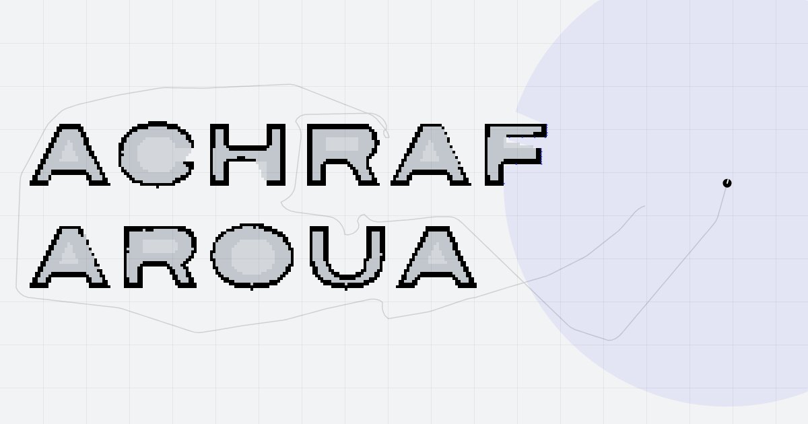

# achref-2.github.io

My portfolio: [achref-2.github.io](https://achref-2.github.io)



## The robot at the top

The name at the top of the page is drawn as an occupancy grid. A small robot with a simulated 360° lidar explores it, the same way the TurtleBot3 does in my [Map → Plan → Drive](https://github.com/achref-2/ams-map-plan-drive) project:

- **Mapping:** every 40 ms the robot casts rays through the grid (DDA). Cells a ray passes through are marked free, and the cell it hits is marked as a wall.
- **Choosing where to go:** a breadth-first search finds frontiers, meaning free cells next to unknown space. They are grouped into clusters, and each cluster is scored by size and distance.
- **Getting there:** A* on an 8-connected grid, with an inflated costmap so the robot keeps its distance from walls, then line-of-sight smoothing.
- **Your turn:** click anywhere on the map to send the robot there.

Everything is plain HTML, CSS and JavaScript in `index.html`, with no build step and no dependencies. If your system asks for reduced motion, the map is shown already finished.

## Run it locally

```bash
python3 -m http.server 8000
# open http://localhost:8000
```

## Files

| Path | What it is |
| --- | --- |
| `index.html` | The whole site, in English and German |
| `404.html` | Page-not-found page |
| `Achraf_Aroua_CV.pdf` | My CV |
| `fonts/` | Archivo, self-hosted (SIL Open Font License) |
| `img/`, `shots/`, `certs/` | Portrait, project screenshots, certificate |
